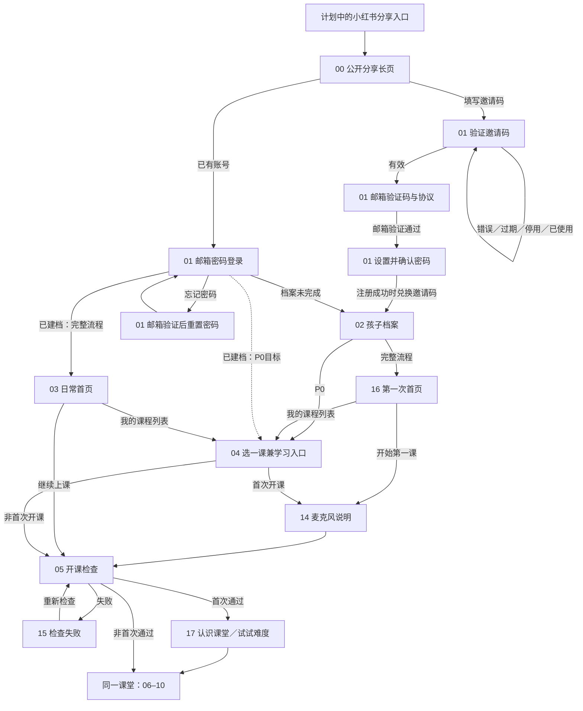
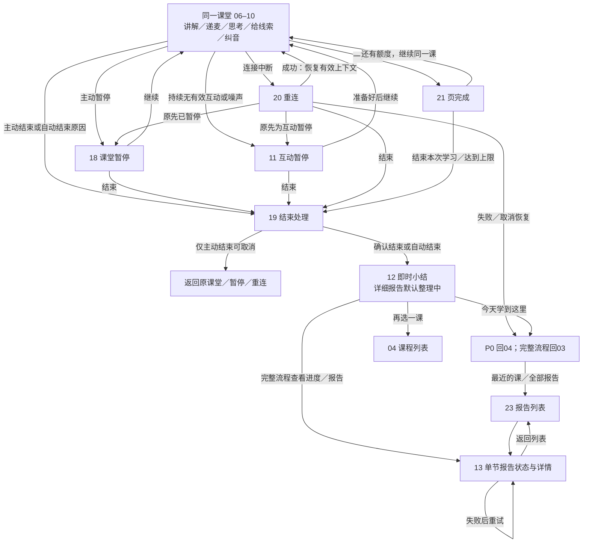

# Teeko 当前页面流设计基线

日期：2026-10-31。依据：本轮用户审阅、[当前产品方向](../product/current-product-direction.md)、[SPEC](../specs/teeko-v1/spec.md)与[验收场景](../specs/teeko-v1/acceptance.md)。原始 PRD、DESIGN 和旧图片保留原文，本文件用于后续分工与实现。

## 范围与阅读约定

- 产品为电脑和平板浏览器网页，目标为 8–13 岁，一个账号对应一个孩子。落地页可以滚动；课堂和应用主要动作尽量留在一屏。
- 当前审阅入口为 `/prototype#00`。共 **27 个有效页面状态**：00 及 01–29 中除去 22、24、26；屏号沿用旧资料，不重新编号。
- 01 包含邀请码、邮箱验证码、设置密码、密码登录、找回/重置等子状态，不为每一步新增顶级页面。06–10 是同一课堂的表现，不是五节课或五条正式路由。
- 以下图表达正式产品应遵守的页面关系，并标注 P0/完整流程差异。原型能够切换页面，不代表真实账号、权限、语音、报告和持久化均已接通。
- 原型外层的全貌、目录、路线、情景与示例邀请码按钮是审阅工具，不属于正式产品导航，也不能作为登录或开课的绕行入口。

## 从公开介绍到第一次上课

公开落地页是爸爸陪学分享的延伸：陪孩子学英语时摸索方法，再结合 AI 做出 Teeko，邀请有需要的家庭一起试用。小红书是计划中的内容来源，不在文档中假定已有账号、真实链接或用户证言。

注册入口统一要求邀请码。验证邀请码本身不消耗名额，成功完成注册后绑定一个新账号；登录与找回不重新填写。离开注册、换邀请码或证明过期，旧证明和密码草稿失效。正式后台需防止直接调用注册接口绕过准入，不能仅依赖页面顺序。见 TK-R-001/025、TK-AC-001/037。

02 只填写称呼、年龄段（8–9 / 10–11 / 12–13 岁）及可观察的英语基础，保留“不确定”。已有档案的编辑从 25 进入，保存后回 25，不重走新用户引导。16 的“开始第一课”与 03 的“继续上课”旁均有“我的课程列表”；顶部不重复放报告入口。见 TK-AC-002/024。

04 的课程为平级主题，每课只有介绍与一个“跟 Teeko 老师一起学”开课动作；没有年级、学期、单元或三种学习模式。14 先说明麦克风用途，05 再检查，15 解释失败与重试。正式权限应由用户明确操作触发；摄像头关闭不阻止上课。17 仅引导直接开口、暂停及试试难度，不恢复慢一点、字幕或重说菜单。见 TK-AC-003–006。

## 课堂、暂停、结束与报告

- 06–10 随真实轮次与教学事件转换，不按固定脚本强制顺序推进。卡住可换问法、给线索、跳过；提示后完成与独立完成分开记录。教材为主，右侧师生窗口；课堂工具只保留指针、画笔、撤销，笔迹位于教材上方、弹窗下方。见 TK-AC-007–014/025/033。
- 11 的依据是持续无回应、环境嘈杂或无法有效交流，用老师第一人称解释原因，例如“我好一会儿没听到你说话了”。关摄像头、未出镜或短暂思考不触发暂停；判断方法与阈值仍待真实音频验证。18 只提供继续与结束。见 TK-AC-015/027。
- 20 恢复的是有效检查点与上下文。网络恢复不能解除原先的互动暂停；从重连/暂停进入 19 后取消，须回到原状态。已结束课堂不会被迟到回调恢复。见 TK-AC-016/017。
- 19 区分五种结束原因：**中途主动结束、内容学完、课时时间到、单课硬上限、每日上限**。只有主动结束可取消；默认突出继续，Esc 取消。其他原因说明后进入小结，不继续本次课堂。结束、保存和计次应幂等。课时与平台上限参数仍待确定。见 TK-AC-018/019/032。
- 21 代表一页完成，可以继续当前课下一页；没有单元完成、下一单元或单元成就。正式结束仍应走统一结束与保存逻辑。
- 12 先展示已确认的小结，详细报告可以几分钟后完成；允许离开后再看。报告有整理中、完成、失败、简版，不能自动假成功。练习建议引用具体卡点、纠正和后续表现，不把提示后完成记作独立掌握。P0 必须能在小结中处理最小报告状态，不依赖 P1 的 13/23 才能下课。见 TK-AC-020/028。

短鼓励、烟花、贴纸和音效属于课堂事件反馈，可关闭音效，减少动画时保留静态鼓励；不增加积分、排名或虚构口语评分。见 TK-AC-034。

## 页面与进入、退出约定

| 屏号 / 状态 | 主要进入与退出 | 异常与阶段边界 |
|---|---|---|
| 00 公开落地页 | 公开浏览；填写邀请码进 01 注册；登录进 01 密码登录 | 长页可滚动；人物与课堂明确为示意，不建语音会话 |
| 01 账号流程 | 邀请→邮箱验证→设置密码→02；老用户登录→学习入口；找回→密码登录 | 邀请/邮箱/密码错误留在对应子状态；离开撤销临时证明；真实账号服务待接入 |
| 02 孩子档案 | 新用户保存→P0 04 / 完整流程16；25编辑→保存回25 | 最少字段与具象选项；名称缺失留在本页 |
| 03 / 16 首页 | 继续上课 / 开始第一课；相邻课程列表入口→04；最近课 / 全部报告→13/23；头像→25 | P1；16为空状态，03为已有学习记录；不重复顶栏报告入口 |
| 04 课程列表 | 选择平级主题，单一开课动作→首次14 / 非首次05 | P0学习入口；无单元或年级筛选；恢复点缺失应明确反馈 |
| 14 / 05 / 15 开课准备 | 说明→检查；失败→重试；通过→首次17 / 非首次课堂 | P0；正式麦克风不可用阻止开课，未知指标不显示良好；当前检查为模拟 |
| 17 第一课 | 操作介绍与示例难度→课堂 | P0；不把示例定级当真实测评，题数与判定待验证 |
| 06–10 课堂表现 | 同一课堂按轮次和教学事件变化；可进入暂停、重连、结束、页完成 | P0；停止/换页/改口后旧任务失效；当前原型未接真实语音课堂 |
| 11 互动暂停 | 持续无有效交流时进入；继续或结束 | P0；不能由摄像头关闭触发；检测阈值待实测 |
| 18 主动暂停 | 课中暂停；继续回有效轮次，或进入结束 | P0；暂停停止采集、播放、推进与过期任务 |
| 19 结束处理 | 课中退出或自动结束；确认→12；仅主动结束可取消 | P0；取消回原态；额度/结束原因由正式后端判定 |
| 20 重连 | 链路中断；成功恢复原状态；失败回P0 04 / 完整流程03 | P0；进度可恢复不等于新连接已恢复上下文 |
| 21 页完成 | 继续当前课，或统一结束后到12 | P0；上限变体只能下课，不跳到单元完成 |
| 12 即时小结 | 结束后进入；可再选课或回学习入口 | P0；报告默认整理中；完整流程可去13；统计不从模型猜测 |
| 13 / 23 报告 | 首页最近课 / 全部报告进入；列表→详情，详情返回列表 | P1；整理中、失败重试、简版；建议需可追溯课堂证据 |
| 25 我的 | 首页头像进入；档案编辑→02；偏好→27；隐私→28；帮助→29 | P1；设置和隐私直接进入，无家长算术题门槛；退出登录需正式清会话 |
| 27 教学偏好 | 25进入；保存语言、风格、声音、供应商和音效；返回25 | P1；GPT Live/通义分别适配；真实静默检测不等于完整课堂畅通或VPN检测 |
| 28 隐私与数据 | 25进入；查看说明、删除/注销确认；返回25 | P1；真实删除/注销需身份验证与独立确认；当前不操作真实数据 |
| 29 帮助与反馈 | 25进入；查看问题或反馈；返回25 | P1；当前不发送反馈；正式渠道和处理方式另行接入 |

旧链接只做兼容：`#22 → #12`、`#24 → #03`、`#26 → #27`；目录与顺序导航不恢复这三页。取消的单词本、单元逻辑和家长答题门槛也不通过其他入口加回。见 TK-AC-029/031。

## 布局、路由与并行开发边界

### 长页与一屏操作

- **可滚动**：00 公开介绍按内容自然滚动；窄屏纵向堆叠，导航定位到段落，不能滚动到错误的原型屏号。
- **主要操作一屏可达**：档案、首页、选课、开课准备及课堂。长课程列表、报告、设置用分区、页签或分页；不能靠整体缩小字号或隐藏按钮达到表面无滚动。
- **课堂持续可用**：教材、师生窗口、标注工具、暂停与结束应在当前视口可操作。老师与孩子链路分别展示，未检测显示未知；课堂头部不露出供应商或共享课本标签。
- **无障碍**：键盘焦点清楚，错误关联表单，FAQ可展开，减少动画偏好生效；落地页AI儿童只用于演示，不构成真实摄像头能力。

### 正式路由候选

[Railway架构](../plans/2026-10-31-teeko-architecture-design.md)中的 `/`、`/login`、`/onboarding`、`/home`、`/courses`、`/classroom/:id`、`/reports`、`/settings` 是正式路由规划，尚未替换当前应用。`#00` 等仅为原型审阅屏号，不直接变成生产URL。

正式 `/` 迁移为公开介绍时，应保留旧课堂回归入口并按独立迁移计划处理；不能直接覆盖当前 `/` 真实课堂。登录状态、建档状态、可用课程和课堂恢复点应由后端决定，不能沿用原型目录自由跳屏的行为。

### 后续接入的责任边界

- 前端负责显示状态、收集输入和本地即时笔迹；Railway后端负责身份、邀请原子兑换、进度、额度、课堂租约、有效状态及报告任务。
- 00 的公开内容可独立交付；01/02 的真实账号接入、课堂状态与供应商适配、异步报告可以依契约分工。共享页面流、事件、状态和错误码先对齐，各实现不能擅自新增单元、字幕或家长门槛。
- 当前账号和兑换为内存原型，刷新重置；真实Resend、课堂音视频、自动暂停与报告后台仍待接入。27 的用户主动静默连接检测已复用真实服务，应与模拟开课检查分开描述。
- 原型的“P0跳转”用于审阅，不是完整的阶段路由守卫。现有01老用户成功固定去03，04返回固定去03，21结束按钮直接去12；正式接入时应按上述P0入口与统一结束约束收敛，不能把这些快捷跳转当作已验收业务逻辑。

后续验收以[验收场景](../specs/teeko-v1/acceptance.md)为准；当前原型测试、浏览器布局检查不能替代真实邮件、家庭网络、平板语音或后端并发验收。

首批worktree基础开发已验证Node HTTP与任务上下文契约，未改变本文正式页面流，也未接通真实账号/课堂/报告。当前集成与剩余依赖见[并行计划](../plans/2026-10-31-parallel-foundation.md)。
