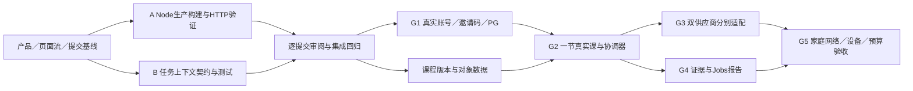

# 文档基线与 worktree 并行基础开发

日期：2026-10-31。用户授权：总结当前产品/设计与架构倾向，并尝试git worktree分步并行开发。

**Goal:** 保存当前已确认的产品和页面流，建立可复用的提交基线，在独立worktree中推进两块互不覆盖的第一批基础工作。

**Architecture:** Railway为已选平台；正式Node入口、PostgreSQL、Jobs和双供应商接入分阶段验证。第一批将“Node生产构建兼容性”和“课堂异步结果上下文围栏”分离，保持旧开发入口和真实课堂不变，检查通过后逐项集成。

**Tech Stack:** 仓库锁定的Next/React/TypeScript、Node内置能力、现有Zod及node:test。复用本地依赖，不复制凭据，不创建云资源。

## 1. 文档职责

- docs/product/current-product-direction.md：派生的当前产品方向与架构决定；原始PRD不改写。
- docs/design/page-flow.md：从00公开介绍开始的新老用户、课堂、报告和设置流；明确屏号、正式候选路由、子状态和异常。
- 产品/设计/SPEC入口链接两份当前基线；SPEC和tasks追踪实际状态。

## 2. Git和隔离方式

1. 当前原型/素材/文档尚未提交。先检查候选文件和凭据模式，仅提交已知产品、原型与测试路径为本地基线，不push。
2. 从同一基线创建codex/前缀分支与独立worktree。每条任务只改自己的文件；不共同编辑package/config/SPEC索引。
3. 依赖用本机node_modules只读复用；构建输出、临时文件、测试工件留各自目录。任何install/lockfile更新需任务负责人统一处理。
4. 不复制.dev.vars、.env、账号会话或云凭据到worktree，不启动额外的真实供应商连接。
5. 各分支定向测试并提交；集成逐个进行，先检查文件范围和冲突，再在主工作目录验证。分支未合并与未通过检查要如实记录。

## 3. 第一批任务边界

### A. Node构建兼容性 G0

- 目标：提供独立可执行的正式Node构建验证路线，识别并隔离Cloudflare专属导入，保留默认Vinext开发与Railway旧启动命令。
- 不将Next构建成功当作WS升级、邮箱认证、PG或部署已完成；不能让公网伪造Sites身份。
- A独占：lib/server/runtime-env.ts、lib/ai.ts、lib/voice-server.ts、app/api/voice/stream/route.ts（仅捕获当前请求配置）、worker/index.ts、scripts/run-node-framework.mjs、package.json中新增的build:node/start:node，以及独立runtime-env/node-framework测试与验证记录。后因生成物冲突，明确授权A最小修改next.config.ts、.gitignore并新增tsconfig.node.json：专用flag启用独立.next-node；基础tsconfig、lockfile、Docker、railway.json不改。
- 最小方案为请求级AsyncLocalStorage绑定适配，Node读取服务端环境；保留Worker connector上下文。Node候选入口强制Railway身份隔离，匿名或伪造Sites头都不能获得业务权限。
- 定向测试→typecheck→NEXT_TELEMETRY_DISABLED=1 npm run build:node→本地生产HTTP冒烟→默认Vinext构建回归。Next构建不是Node WS实现。

### B. 课堂任务上下文围栏

- 新建lib/domain/classroom-context.ts和tests/classroom-context.test.ts；只依赖Zod与类型，不依赖Node、PG或供应商。
- 区分业务课堂状态和任务结果所属上下文，携带logicalSessionId、courseVersion、connectionEpoch、stateRevision、pageId、activityId。
- 应拒绝暂停/结束后的结果，以及错误会话、连接代次、课程版本、页面、活动和修订号的迟到结果；输入有界、整数安全、额外字段不可带客户端权威标记。
- 这是候选结果的范围校验，不能替代账号权限、数据库租约、对象存在性、额度或幂等账本；不提前接入旧课堂或改变其行为。
- 测试先红再绿，覆盖换页、换题、重连、暂停/结束和格式错误，合格结果保持不变。

## 4. 集成顺序和验收

文档与基线 → worktree并行A/B → 定向测试/审阅 → 按提交逐项集成 → 原型41项及相关现有测试、typecheck、默认build → 记录G0仍未通过项目。

没有生产部署、密钥迁移、发邮件、邀请码私发或DNS操作。下一批才接正式身份/邀请/数据库与真实会话控制；供应商/设备/家庭网络仍需各自验收。

## 5. 本次工作目录与依赖顺序

本地基线提交：`854afa3`（当前原型、素材、产品/设计文档），未推远端。基线纳入137个已知项目文件；归档PRD和两份字体许可证自带空白，按原文保存，派生文档与代码空白检查通过。没有提交环境文件或密钥。

| 路线 | worktree | 分支 | 所有权 |
|---|---|---|---|
| 集成 | /Users/chengxia/AItutor | codex/railway-deploy | 当前产品/设计/SPEC索引、任务及集成记录 |
| A：Node G0 | /Users/chengxia/AItutor-worktrees/node-g0 | codex/teeko-node-g0 | 上述Node运行时、启动脚本、独立测试 |
| B：任务围栏 | /Users/chengxia/AItutor-worktrees/classroom-context | codex/teeko-classroom-context | lib/domain/classroom-context.ts、独立测试与验证记录 |

后续可并行，但须先冻结共享边界：账号与课程可在Node/数据契约后分开；两家供应商依赖同一课堂上下文/回执；报告依赖已提交证据和终态。不能让各分支分别设计互不兼容的登录、结束或报告状态。

B分支来源提交：`ef845af`，45项上下文定向测试、typecheck、eslint与独立审阅通过。A分支审阅发现WS外部事件不自动继承请求AsyncLocalStorage，需在建桥时捕获该请求配置，避免原有Relay回归；未扩展为Node WS迁移。

## 6. 首批集成结果

| 路线 | 来源提交 | 主目录集成提交 | 结果 |
|---|---|---|---|
| B：任务上下文 | ef845af | 493b985 | 45项定向测试、类型检查、eslint及独立审阅通过；只接受仍属当前active范围的候选，未连接真实课堂 |
| A：Node HTTP | 376b751 | 87592d0 | 21项运行时/旧语音定向测试通过，独立Next生产构建、显式HTTP冒烟、默认Vinext构建和typecheck连续通过；WS/账号/PG仍未完成 |

主目录集成后运行108项：107通过、1项按设计默认跳过（Node生产冒烟已在无本地env文件的Node worktree用TEEKO_NODE_SMOKE=1显式运行1/1通过）。主目录typecheck、默认build、diff检查及当前文档链接/围栏检查通过。没有重复运行真实供应商连接或将这些检查称为家庭端到端验收。

审阅中处理两项实际兼容问题：WS外部EventTarget消息不继承HTTP请求ALS，改为建桥时捕获当前连接配置；Next与Vinext覆盖同一.next/types，改为Node独立产物目录和专用类型配置。两项修复均有对应测试/连续构建证据，最终独立复查无阻塞项。

两个worktree和源分支保留供回溯，生成物与只读依赖软链不提交。后续任务应从最新集成提交创建下一批分支，不把旧实验工作树的历史文档当最新产品决定。所有提交仅在本地，未push、未部署，未复制真实环境文件/凭据。

下一批建议顺序：完成Node受控WS与连接关闭能力、确定正式PG/认证事务边界；再并行接邀请/邮箱账号和版本化课程，之后一节真实课、第二供应商与证据报告。未完成项在tasks和架构第19节保留明确状态。
