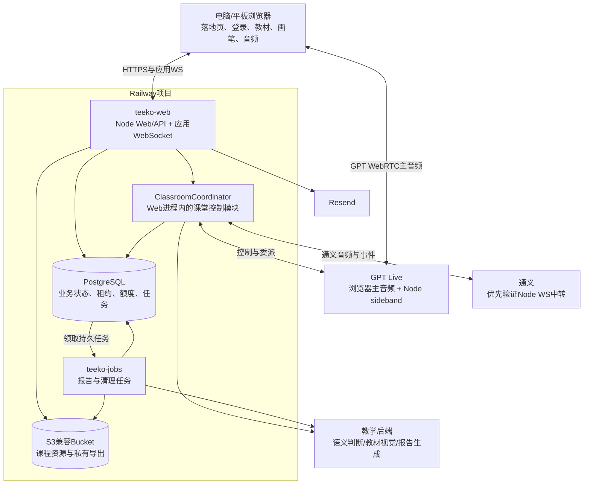
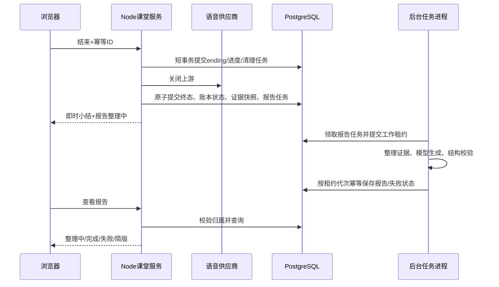

# Teeko 重构技术架构方案 · Railway

日期：2026-10-31。版本：v0.4。状态：**Railway已由用户选定；本地Node HTTP与任务契约基础已验证，完整服务迁移和部署尚未完成**。

本版根据用户纠正完整替换上一版Cloudflare主方案。保留前端/课堂控制/模型分层，将数据库、实时会话、任务、文件与部署落实到Railway正式Node环境。Cloudflare只可选承担域名/DNS，不作为计算、数据库或任务系统的依赖。

依据：[当前SPEC](../specs/teeko-v1/spec.md)、[验收场景](../specs/teeko-v1/acceptance.md)、本轮原型审阅和仓库实际实现。原始PRD与设计源保持不变。除第19节列出的本地基础切片外，下文模块、表、接口和目录仍为拟议设计，不能当作已接通的运行时API。

## 1. 已确定的主方案

**Railway Web服务 + PostgreSQL + 后台任务服务 + S3兼容对象存储 + Resend**。保持一个仓库，业务按模块分工，Web与后台进程使用同一版本代码。首版不引入微服务集群、Redis、Kubernetes、向量库或视频会议SFU。

| 运行单元 | 方案与职责 | 首版边界 |
|---|---|---|
| teeko-web | Railway常驻Node服务，提供落地页、正式应用、HTTP API、应用WebSocket与实时课堂连接 | 首版1个副本；不能把内存当持久状态 |
| PostgreSQL | Railway项目内数据库，保存账号、课程索引、课堂、进度、租约、额度、证据和任务 | Web与后台服务通过私网访问，不公开数据库端口 |
| teeko-jobs | 同仓库独立后台进程，领取持久任务，生成报告、重试清理、修复卡住的任务 | 不分配公开域名，不处理浏览器实时音频 |
| ObjectStorage | 优先验证Railway Buckets的S3兼容接口，保存发布课程资源与私有导出 | 公开课程与私有文件分开访问控制；不默认录制儿童音视频 |
| Resend | 注册与找回验证码等事务邮件 | 仅发信；账号和验证由AuthService负责 |
| 域名/DNS | teeko.app指向Railway Web服务；现有DNS若在Cloudflare可继续使用 | 不强制将动态API/WS经过额外代理；不依赖D1、DO、R2或Workflows |

Railway提供[常驻服务部署](https://docs.railway.com/build-deploy)、[私网](https://docs.railway.com/networking/private-networking)和[S3兼容Buckets](https://docs.railway.com/storage-buckets)。本方案选择这些能力，不代表已经为本项目创建或配置资源。

### 产品边界

- 8–13岁、电脑和平板浏览器，一个账号一个孩子，一次一节活动课堂。
- 新增公开落地页介绍理念、上课方式与家长问题，进入邮箱注册/登录；预览不是匿名真实课堂。
- 先验证私发邀请码，再验证邮箱并设置密码；后续密码登录，邮箱找回/重置。注册只保留《用户协议》一个入口。
- 平级课程，无单元、年级、多孩子、单词本或支付；正式课程需人工校对和发布。
- 设置选择GPT Live/通义、授课语言、风格、声音与音效；孩子课堂不展示供应商标签。
- 教材为主，右侧Teeko形象与孩子头像；P0/P1不采集摄像头。工具仅指针、画笔、撤销，已取消慢一点与字幕等快捷菜单。
- 不承诺未测试的并发容量、延迟、固定月费或网络可达性。网络验证决定地域/代理配置和服务可用范围，不重新把Railway降为备选。

## 2. 当前实现与必须迁移的地方

| 领域 | 当前代码事实 | Railway正式方案的处理 |
|---|---|---|
| 原型 | components/prototype提供27个有效状态，含新增00落地页；账号和业务示例仍在内存 | 原型继续审阅，正式入口读取服务端数据，不静默回落成演示成功 |
| 框架 | 默认仍为Vinext/Worker；已新增独立Next Node生产build/start与HTTP验证切片 | Node产物隔离到.next-node；正式受控WS与默认部署切换仍待实现 |
| Railway配置 | Dockerfile与scripts/start-railway.mjs存在，但实际运行wrangler dev --local | 替换生产构建、启动、健康检查与优雅关闭；仅有这些文件不等于正式服务已就绪 |
| 身份 | app/chatgpt-auth.ts依赖Sites身份头，在Railway返回未登录 | 改为自有AuthService与HttpOnly Cookie；公网传入的Sites头不构成身份 |
| 数据 | lib/storage.ts使用IndexedDB；db/schema.ts为空；db/index.ts接D1 | Drizzle改PostgreSQL驱动，建立账号隔离与迁移；IndexedDB只做缓存和待确认事件 |
| 配置 | lib/server/runtime-env.ts已按请求隔离Worker绑定，Node回退服务环境；建桥时捕获后续WS回调配置 | 该边界不等于正式账号/权限；前端只得到允许公开的能力信息 |
| 实时 | GPT/通义现均有浏览器WebRTC路径；GPT已有客户端委派但无服务端sideband | Node持有服务器控制连接；通义正式中转需要新增，不伪称已有强制断流 |
| WS中转 | voice-bridge等使用Worker WebSocket能力，现有中转覆盖豆包/智谱 | 复用协议和校验，替换为Node受控升级与WS连接；本轮只设计GPT/通义的正式路线 |
| 互动 | classroom.ts、canvas-snapshot.ts、音频工具与测试可复用 | 与课程版本、服务端提交、取消和回执关联 |
| 报告 | 原型已有整理中/失败/简版界面 | 用PostgreSQL持久任务、证据快照与独立后台进程生成 |

保留旧根路径课堂作为迁移回归参考；在替换完成前，落地页先在/prototype#00审阅。将来正式根路径/为落地页，旧课堂不能未经迁移直接删除或改成不可访问。

### Node生产入口

推荐使用仓库已依赖的Next.js正式Node构建，统一Node入口转发页面/HTTP并处理受控的应用WS升级。若采用custom server，就按[Next官方说明](https://nextjs.org/docs/app/guides/custom-server)单独打包入口，不与standalone输出方式混用。G0先验证当前锁定版本；不因为文档有更新就升级依赖。

生产必须监听Railway分配的PORT和0.0.0.0，使用NODE_ENV=production；TLS由部署入口承接，应用正确处理可信代理信息。移除可达生产代码中的Cloudflare专属导入与WebSocketPair，改用明确的Node适配，不做全库字符串替换。

本轮不修改Dockerfile、安装依赖或触发部署，避免设计修改直接改变运行环境。

## 3. 总体结构

这是职责与通路图：ClassroomCoordinator是Node模块，不是额外的云平台服务；PostgreSQL是持久事实来源。GPT主音频通常不经Web服务，通义中转则需要测量额外带宽与延迟。

## 4. 模块与边界

| 模块 | 输入与输出 | 约束 |
|---|---|---|
| PublicSite | 产品理念、上课方式、家长问题 → 注册/登录 | 无登录可浏览；无麦克风/相机采集；不假造口碑、效果、价格和真实演示 |
| AuthService | 邮箱/验证码/密码 → 身份与会话 | 注册证明与正式登录隔离，所有业务API统一验证 |
| ProfileService | 当前身份 → 一个孩子档案与偏好 | accountId来自服务端身份，不信任客户端归属字段 |
| CourseService | 发布版本 → 课程、页、对象与目标 | 发布版本不可原地改写，历史会话绑定版本 |
| ClassroomDomain | 当前状态+事件 → 新状态和候选动作 | 纯领域规则，不依赖Node、PG或供应商事件名 |
| ClassroomCoordinator | 设备租约、实时事件 → 版本化提交和上游命令 | 可暂停、取消、重连、结束；防止旧回调复活 |
| VoiceProviderAdapter | 供应商协议 ↔ 统一应用语义 | 两家分别适配，不把GPT append原样发给通义 |
| TeachingBackend | 受限上下文 → 解释/提示/判题建议/视觉结果 | 只提出候选，应用验证后提交 |
| ReportService/JobRunner | 已结束会话证据 → 报告与可重试状态 | 不阻塞下课，不凭空生成学习结论 |
| InfrastructureAdapters | PG、S3、邮件、时钟、配置、连接与任务 | 运行时依赖限制在边界，便于测试和迁移 |

建议逐步建立lib/domain、lib/server、lib/providers及正式页面组件分区。按一条链路提取，不先整体搬动所有文件。/prototype保留独立示例数据，正式页面不能拿演示数值冒充真实结果。

## 5. 落地页与应用路由

正式规划：/公开落地页，/login登录注册，/onboarding建档，/home学习首页，/courses课程列表，/classroom/:id课堂，/reports报告，/settings设置。

公开落地页按用户确认的第二版图采用爸爸陪学分享语气：陪学摸索→AI工具→使用步骤→邀请一起试试。允许长页滚动，不受应用一屏操作约束。照片质感儿童只作明确标记的AI课堂示意；不编造作者家人、口碑和教学效果。窄屏内容可读，不压小字号或裁掉按钮。

“填写邀请码”定位到邀请区，验证后进入邮箱验证码注册；“登录”进入密码登录，“先看看怎么用”只滚动到步骤。公开介绍不直接打开计费语音会话或申请麦克风。账号页面可回落地页。公开页面与静态品牌资产可缓存，用户资料、认证、课堂、进度和报告不得被公共缓存。

正式落地页需可被搜索引擎读取的正文、真实标题/描述和站点链接；不先加虚构评价或流量分析。当前/prototype#00用于审阅，当前hash审阅入口不是将来的SEO方案。

## 6. 账号、密码与Resend

首选验证候选为Better Auth + Drizzle PostgreSQL，复用成熟密码和会话实现。其官方文档覆盖[邮箱密码](https://better-auth.com/docs/authentication/email-password)、[Email OTP](https://better-auth.com/docs/plugins/email-otp)、[Drizzle适配](https://better-auth.com/docs/adapters/drizzle)。具体锁定版本与新Node入口仍需G0验证。

注册流程：发送用途为register的验证码→服务端校验→签发邮箱绑定、短期一次性的registrationProof→设置/确认密码→消费证明完成账号创建并建立正式会话→建档。在设置密码前不得获得课堂权限；不能开放绕过证明的匿名密码注册接口。

找回流程：发送独立password_reset验证码→取得仅可重置的证明→保存新密码→撤销旧会话、提升authVersion并关闭活动课堂→回密码登录。注册和找回的验证码、证明不能跨用途或跨邮箱复用；不自动覆盖已有账号。

- 密码用库验证的安全哈希，不复用原型SHA-256；OTP应受保护存储、限尝试/限发送、一次消费，不能写日志。
- 使用Secure、HttpOnly、合适SameSite的同源Cookie；写请求和WS握手校验Origin/认证，受限返回跳转路径。
- 公网头不能伪造Sites登录；正式API不能把只读状态检查通过当已授权课堂。
- 重置撤销与课堂关闭通过持久任务重试，不能只清当前浏览器Cookie；活动连接持续校验租约与认证版本。
- 记录一个《用户协议》的版本和同意时间；正式文案、用途及留存沿用TK-D-015的待核对项，不从界面删除链接推定要求已完成。
- Resend API密钥在Railway Secret/环境变量，须核对发件域名和实际收件；邮件发送成功不等于用户已收件或已通过验证码。

### 私发邀请码与注册准入

用户已确认邀请码制，默认一码一个新账号，由用户私下分享。公开介绍可浏览，首次注册必须先验证邀请码；已有账号登录/找回不重新消耗。

- PostgreSQL新增invitation_codes：随机不可枚举code的受保护摘要、issuedBy、expiresAt、disabledAt、redeemedBy/redeemedAt；明文码仅发码时展示，不存普通日志，不在页面暴露正式码清单。原型TEEKO示例码不可用于生产。
- POST /api/v1/invitations/verify是拟议应用接口：限流后检查可用性，签发短期服务端证明，由受限Cookie引用。验证不消耗，进入邮箱验证；证明离开/到期撤销，不以客户端verified布尔值授权。
- 最终注册再次校验邀请、邮箱证明与当前状态。在短事务内锁定邀请行，确认未兑换/未停用/未过期后绑定账号，重复请求幂等；两个请求竞争只能一个账号激活。校验后才停用/到期的码仍须在提交时失败。
- 直接调用认证库注册入口同样受服务端准入约束。G0核对库是否支持账户创建与兑换共用事务；不能共用时使用不可访问课堂的pending账号，完成兑换后激活，并设计失败补偿。不能先放行账号、再异步扣邀请码。
- 登录、会话续期和找回检查账号激活状态；未完成邀请兑换不能取得业务权限。一码已使用时提示登录，不泄露绑定邮箱。
- 发码/停用先提供受控运营操作，暂不增加公开后台页面或自动私信；实际私发由用户完成。本轮只实现本地内存原型，未开通真实发码与访问控制。

G0验证认证库如何支持先OTP再密码的完整流程，必要时用受控AuthService扩展；不能默认OTP登录就符合产品流程。密码长度、验证码期限、冷却、尝试次数与Cookie期限配置化，原型数字不直接冻结成正式规则。

## 7. 课程、偏好和跨设备恢复

课程按courseId+courseVersion发布，包含介绍、manifest、页图键、对象ID与归一化框、学习目标、示例表达、可接受答案和提示。不新增CMS或用户上传；先准备一份人工校对课程。

- 新课堂冻结课程和教学偏好版本；内容编辑不影响历史报告。资源版本不存在则明确失败，不能恢复到另一课。
- 目标结果区分independent、assisted、skipped、unassessed；提示后答对不记独立掌握，跳过不记掌握。
- 语言/风格/声音/供应商偏好服务端持久化，原则上下一次连接生效；音效静音可本地立即执行。
- IndexedDB只缓存资产、待确认笔迹和lastAckSeq。服务端确认后才显示已保存，不吞掉保存失败。
- 恢复以PostgreSQL已提交检查点为准；旧版本地数据如需导入，单独预览并确认归属，不按邮箱猜测导入。

## 8. 课堂状态、并发与进程重启

首版teeko-web一个副本，ClassroomCoordinator持有上游连接、取消句柄、短期转写和本地执行队列；**进程内Map仅是连接缓存，不是状态数据库**。PostgreSQL保存活动课堂、设备租约、进度、额度、事件序列和上游sessionId。

### 数据库权威与租约

- accounts或专用account_runtime行承载账号级串行边界。开课在短事务中锁行，检查已有课堂/额度并建立唯一活动租约；不依赖前端判断“没有另一节课”。
- 每个逻辑课堂绑定ownerInstanceId、leaseExpiresAt、connectionEpoch与stateRevision。新的进程只能在合法交接或租约过期后接管；提交必须带预期版本与当前代次。
- 进程定期续约，失去数据库连接或续约失败时停止新工具/语音生成并主动关闭上游，不在分区期间继续自称owner。
- 不把锁或数据库事务保持整节课，也不在事务内等待模型HTTP/WS响应；外部调用前取版本，返回后再次校验并做条件提交。
- Web服务崩溃后，后台清理器根据持久记录关闭遗留供应商会话并结算；重连创建新的attempt，从检查点恢复，不假设内存或原供应商对话能原样恢复。
- 多副本扩容前必须实现owner路由/转发与租约接管。只有SQL防止重复写，不足以让浏览器WS自动接回持有连接的实例；首版不启用任意多副本或自动水平扩缩容。

### 状态维度

| 维度 | 状态 |
|---|---|
| 业务课堂 | created→preflight→active↔paused→ending→ended；ended为终态 |
| 媒体连接 | idle/connecting/ready/reconnecting/closed/failed；每次重连单独attempt |
| 对话轮次 | teacher_speaking/learner_turn/learner_speaking/thinking，由真实播放与事件驱动 |
| 学习活动 | 当前目标、问法、帮助级别、是否跳过，不等于固定台词脚本 |
| 报告任务 | queued/running/ready/failed/brief，独立于课堂结束 |

统一应用事件包含eventId、logicalSessionId、connectionEpoch、courseVersion、pageId、activityId、expectedRevision和受限payload；服务器生成serverSeq与时间。客户端不能提交可信correct=true、最终用量或课堂完成状态。事件/动作幂等，重发只取已有回执，历史重播不重复奖励。

第二台设备默认提示已有课堂；明确接管后提升代次，关闭旧上游再开启新连接，关闭失败保留closing状态而非同时计费。前端beforeunload只改善误操作体验；真实清理由截止时间、租约和后台任务补足。

暂停停止本地采集、音效与输出队列，取消旧推理，首版建议同时关闭上游以控制成本；继续创建新attempt，保留同一逻辑课堂和累计额度。静音不等于停止计费。

## 9. 两家实时服务与后台模型

| 场景 | GPT Live | 通义 |
|---|---|---|
| 主媒体 | 服务端交换SDP，浏览器WebRTC主音频 | 现有直连可复用验证；正式课堂优先新增Node WS中转并与直连对照 |
| 服务端控制 | Node附加sideband，接收事件、执行私有工具和关闭会话 | 当前未确认等价sideband/远程硬关闭；Node持有上游WS后可主动断流 |
| 后台工作 | 延续client delegation，由我们的TeachingBackend执行 | 从原生工具调用事件归一化任务，调用同一业务后端 |
| 安静更新 | session.thinking.append及相应会话更新，跟踪确认 | 按官方session.update等事件，不发送GPT专用append |
| 返回可说结果 | 已确认事实经session.commentary.append返回 | conversation.item.create中的function_call_output，必要时response.create |
| 视觉 | 独立VisionInspector，不把语音模型当图像模型 | 按实际模型能力接视觉任务，业务不绑定某一实时型号 |

GPT Live的[服务端控制](https://developers.openai.com/api/docs/guides/voice-server-controls)和[委派语义](https://developers.openai.com/api/docs/guides/live-delegation)已核对，当前项目尚无Node sideband。通义的[WebRTC](https://help.aliyun.com/en/model-studio/realtime-webrtc-access)与[客户端事件](https://help.aliyun.com/en/model-studio/client-events)可作为适配依据，当前项目中转未包含通义，需新增并实测。

- 统一connect/configure/context/cancel/tool_request/tool_result/transcript/playback/usage/close语义，同时提供能力清单；不假设事件、音色、关闭和计费相同。
- 保留当前实际配置的实时模型作为验证起点；分别配置voiceModel、reasoningModel、visionModel、reportModel，不自动升级或替换。
- 通义服务组合默认走已明确允许的数据路线；不能前台选通义、后台未经说明仍将孩子转写/截图送OpenAI。跨供应商后台组合需明确配置。
- 男女声要映射真实可用voice ID，不支持的组合提前说明；切服务/音色先关旧连接，再从应用检查点建新连接，不承诺无缝切换。
- 不自动跨供应商故障转移；让用户明确选择，避免数据路线和费用改变。
- 回执只说明配置或上下文注入完成，不能当作老师已实际说完；真实播放状态独立记录。

Node中转会增加网络一跳、带宽与计算开销；完整通话和强制关闭必须与原直连在同设备同网络比较。G0验证创建后立即掉进程、数据库不可用、上游关闭失败等窗口，确保遗留连接有记录、截止与清理策略，不能只靠浏览器倒计时宣称硬额度。

## 10. 连接检测与家庭网络

连接检测分三步：网站与身份/配置可用→点击后静默probe完成握手/初始化并关闭→正式开课验证麦克风、上行、下行及播放。静默成功不代表完整语音听感、长连接或后台委派正常。

GPT Live提示当前浏览器网络/VPN/代理可能影响连接，但不宣称能探测VPN开关。Railway后端可访问OpenAI，不代表孩子浏览器WebRTC必然可用；部署到服务器本身也不解决所有媒体直连问题。

孩子窗口显示本地设备/应用链路，老师窗口显示供应商/接收播放链路。未检测、样本过期或不具备的指标显示未知，不伪造两台真人设备的测速。WS ping只测浏览器至网站，不能当到语音模型的完整延迟。

Railway地域、域名DNS/TLS、代理开关需在目标电脑/平板和家庭网络实测。若DNS目前由Cloudflare托管，可保留；是否打开其代理需验证WS升级、缓存和超时，不在架构修订时更改线上记录。

## 11. 灵活教学、画笔与视觉

学习目标与方法分离。目标可以是表达周末计划，老师可先聊兴趣、问图片、给二选一或句首提示，再回到目标；不能机械重复同一句。温柔/认真/严厉不能覆盖不羞辱、不逼读、尊重拒绝的共同规则。

TeachingBackend只产生候选动作，应用校验对象、课程、活动版本、权限及当前状态后执行。等待模型返回期间换题、暂停或结束则旧结果失效，不执行、不播报、不奖励。跳过与提示归因保留。

- 已知对象先用objectId和几何解析。开放笔迹保持标注用途，闭合手绘圈可以选对象，多选或模糊则澄清。
- 笔迹位于教材内容上方、课堂弹窗下方；指针模式不阻挡内容点击。笔迹本地即时显示、限量采样与批量提交，不每个pointermove都调用模型或写库。
- 奖励由已提交事件决定，以session/activity/awardVersion去重；重连不重播旧烟花，努力鼓励不等于正确判题。
- 音效可即时静音，暂停/换页/取消清队列；避免覆盖老师声音或干扰麦克风。
- “我圈的是什么”等像素依赖问题才调用独立视觉检查，优先课程页+必要笔迹的裁剪合成图，不采集整屏或孩子摄像头。输入和结果携带页/活动/笔迹版本。
- 当前视觉路径为/api/teacher经aiConfig().model调用带图的Responses；新方案抽成VisionInspector。GPT Live的[模型能力](https://developers.openai.com/api/docs/models/gpt-live-1)不包含图像输入。

沉默/噪声暂停组合VAD、能量、识别有效性、老师播放和孩子画笔活动判断。先等待、轻提示，必要时暂停；不能只因ASR没识别、音量大、关摄像头或没出镜触发。原因用老师第一人称，无法确认噪声时说“我有点听不清”，不武断归因。具体阈值需真实家庭场景验证，旧代码时间参数不直接冻结。

P2若确认孩子视频观察，新增独立ObservationAdapter，负责权限、必要帧筛选、视觉任务与时间戳。与教材检查分开，不默认录像/连续截帧，不把表情推断当情绪或能力结论，不因无脸暂停。首版不建真人视频会议设施。

## 12. 小结、报告与持久任务

PostgreSQL同一事务可以同时保存课堂终态、最小证据、结算状态和report_jobs记录，避免结束了却没有报告任务。外部模型、S3和邮件不在数据库事务内，仍需要幂等与补偿，不能称为跨系统事务。

任务使用持久jobs/report_jobs表。首版后台进程以短事务的FOR UPDATE SKIP LOCKED领取待运行或已过期的任务，提交lockedBy、leaseUntil、generation后释放事务，再调用模型。完成时按当前generation做条件写入；超时、重启和失败可重领，设重试上限、退避和可见失败状态。[PostgreSQL SELECT文档](https://www.postgresql.org/docs/current/sql-select.html)指出跳过锁适用于队列式消费，不作为普通业务查询的一致性方式。

- 同逻辑课堂/报告版本只有一个业务结果；sessionId+reportVersion唯一。
- 模型生成后写库失败可重试，供应商请求不一定“只计费一次”；记录尝试并限制预算，不能把数据库幂等冒充外部调用exactly-once。
- LISTEN/NOTIFY若使用只负责唤醒，不能取代持久任务；轮询兜底可恢复。首版不强制Redis/BullMQ，需求确实增长后再评估。
- 上游关闭未确认时显示结束处理/结算未知，后台继续清理；不以页面离开判定计费已停。异常中断可给事实有限的简版。
- 即时小结只用已确认事实。详细报告从证据快照生成，不阻塞下课，用户离开后从最近的课/全部报告查看。
- 练习建议必须引用evidenceId：具体卡点、老师处理、随后是否在提示下完成、建议怎么练。记录不足则说明不足；不能从文字转写给发音分数。

## 13. 数据模型与存储

认证库的用户/凭据/会话/verification表按锁定版本生成。业务表草案如下，均由PostgreSQL保存，不再划分D1读模型和DO活动真相。

| 实体 | 主要字段/关系 | 约束 |
|---|---|---|
| account_profiles | authUserId、onboardingState、authVersion | 邮箱不是业务外键 |
| child_profiles | accountId、称呼、ageRange、selfReportedLevel | accountId唯一 |
| teaching_preferences | accountId、语言/风格/声音/服务组合/音效、version | 新连接冻结配置快照 |
| invitation_codes / registration_proofs | codeHash、期限/停用、兑换账号、短期证明 | 注册激活与单次兑换一致；明文不写日志 |
| agreement_acceptances | accountId、agreementVersion、acceptedAt | 单一协议入口对应版本记录 |
| courses/course_versions | courseId、version、manifestKey、checksum、publishedAt | 版本不可原地改写 |
| classroom_sessions | accountId、childId、courseVersion、状态/原因、revision、serverSeq、summary | 一账号一活动课堂，结束计次幂等 |
| classroom_leases | sessionId、ownerInstanceId、leaseExpiresAt、connectionEpoch、deviceId | 可重启、可接管，旧owner不能继续提交 |
| connection_attempts | logicalSessionId、epoch、provider/model/sessionId、时间、usageStatus | 重连单独记录，额度累计不重置 |
| progress | childId、courseVersion、checkpoint、goalResults、revision | independent/assisted/skipped分开 |
| learning_evidence | sessionId、eventId、activityId、kind、assisted、必要片段/引用 | 事件唯一、内容最小化、保留期明确 |
| usage_ledger/budget_reservations | account/session/attempt、来源、used/reserved、结算状态 | 实测/估算/未知分开 |
| jobs/report_jobs/reports | sessionId、reportVersion、证据/schema版本、state、lease/generation、content | 任务可重领、报告业务键唯一 |

约束和事务保证账号隔离、幂等与额度互斥；数据库层保留必要唯一索引，不能只依赖Node进程内if检查。HTTP、WS与后台写入都检查当前身份/租约/版本。

存储边界：

- 浏览器仅缓存课程、未确认笔迹和本地即时音效状态，不存长期API密钥/正式密码摘要。
- 课程和站点品牌资产可版本化缓存。Railway Bucket保存独立于Web容器生命周期的文件；不能依赖容器本地磁盘保存正式资产。
- 优先采用受控资产路径/签名访问；私有报告按账号授权，不能以不可猜URL代替权限。Bucket的S3兼容不代表默认公开读或已配置CDN，CORS、签名、缓存、传输费用要实测。
- PostgreSQL私网和对象存储访问路径分开核算，不假设Bucket也属于数据库私网免费流量。
- 不默认保存原始音频、视频或整屏截图。报告所需最小回答/纠正片段作为受控业务证据，不写普通日志；保存范围和期限在试用前确认。
- 数据库连接池有上限，Web与后台分别配额；不得让每条WS永久占一个PG连接。数据库不可用时不发起新的计费课堂。

## 14. 应用接口与安全边界

以下是自己的接口草案，非供应商API；认证路径在G0验证后映射。

| 范围 | 拟议入口 | 规则 |
|---|---|---|
| 公开站点 | GET /、公开静态资源 | 不要求登录，不自动采集或建语音会话 |
| 账号 | 发送/验证注册码、完成注册、密码登录、发送/验证重置码、完成重置、登出 | 一次性证明、用途隔离、限流、受控Cookie |
| 当前用户 | GET /api/v1/me | 返回必要显示信息和建档状态 |
| 档案与设置 | GET/PATCH /api/v1/profile、preferences | 从身份派生归属，写入带版本 |
| 课程 | GET /api/v1/courses及版本内容 | 只返回已发布内容 |
| 连接检测 | POST /api/v1/connection-checks | 限流、静默、自动关闭，不等于真实课堂 |
| 开课 | POST /api/v1/classrooms | 校验身份/档案/课程/租约/额度/配置 |
| 事件 | 同源应用WS+订阅/输入/回执 | HTTP升级前认证与Origin检查，绑定session/device/epoch |
| 控制与恢复 | classrooms/:id/pause、resume、end、takeover、snapshot | 幂等、版本检查、关闭旧attempt后再开新attempt |
| 报告 | GET /api/v1/reports、reports/:id及重试动作 | 账号归属、分页、任务去重 |

应用错误区分AUTH_REQUIRED、PROFILE_REQUIRED、ACTIVE_CLASSROOM_EXISTS、PROVIDER_NOT_READY、MEDIA_PERMISSION_DENIED、STALE_REVISION、QUOTA_REACHED、REPORT_PENDING/FAILED。供应商错误正文和内部配置不直接展示给孩子。

账号注销/删除需控制任务、缓存、文件及数据表，并阻止已排队报告重新写回已删除账号；保存必要删除标识/任务版本，在读取和落库前检查。具体留存规则待发布确认，不因本轮架构改动执行删除。

## 15. 额度、成本与诊断

区分课堂经过时长、计费连接时长和有效练习时长；暂停建议关闭上游，静音/沉默不一定停费。同日额度以服务器业务时区分日、UTC记录时间，重连/换服务不能重置。

开上游之前用短事务锁定预算行，建立保守预留与截止时间，再打开连接；失败补偿、关闭确认后结算。模型用量回调缺失则保留未知/估算，不填0。全站预算与账号额度都在服务端，不能只靠页面倒计时。

成本按Web与后台常驻资源、PG与备份、Bucket存储/请求/带宽、实时连接分钟、后台语义/视觉/报告模型、邮件综合测量，不给未核对的固定月费或“免费无限”承诺。

复用live-performance、live-diagnostics、server-timing思路，记录受限指标：连接阶段、模型版本、错误码、首包/首播、动作确认、重连、任务状态与账本偏差。日志不存密钥、密码、OTP、令牌、SDP、邮箱、儿童原话或截图。不自动加第三方埋点。

## 16. 发布、停机与备份

- 开发/测试/生产分别使用数据库、Bucket、域名、邮件和模型配置；不读取/复制本地真实密钥来生成文档。
- Railway Web与Jobs使用同仓库、可区分启动命令的正式镜像；不是在容器中长期开wrangler dev。
- Web提供存活/就绪检查；发布收到SIGTERM进入draining，拒绝新课堂，保存检查点、关闭上游和WS。不要将开机健康检查误当完整会话健康监控。
- 部署交接可能让新旧进程短时并存，因此即使首版1副本也需要PG租约/epoch。设置合理终止窗口并实际测试，不能保证长通话发布时永不断线。
- Jobs停机先停止领取新任务，释放或让工作租约过期；新进程按持久任务恢复。上游清理任务优先，不能被报告生成长期阻塞。
- 数据库迁移单独执行并保留向前兼容窗口；代码回滚不等于数据自动回滚。认证/任务表与业务模块升级顺序可检查。
- 按[Railway备份与恢复说明](https://docs.railway.com/guides/postgres-backups-restores)验证所选方案的备份、PITR与逻辑导出，并进行独立环境恢复演练；不宣称创建数据库就自动具有已验证恢复能力。
- DNS/CDN修改、服务创建、费用配置及生产部署均不属于本轮设计实施。

## 17. 分阶段迁移与验收

| 阶段 | 交付物 | 验收 |
|---|---|---|
| G0：Railway迁移验证 | 正式Node镜像、同源HTTP/WS、PG、Bucket最小读写、认证/邮件样例、GPT sideband与通义中转样例 | 不依赖cloudflare:workers/Sites身份；邀请码→邮箱→密码→找回；一码并发只有一个账号激活；能强制清理连接；目标家庭网络完整语音；停机/重启/租约窗口 |
| G1：落地页与真账号课程 | 正式分享长页、邀请码准入、邮箱账号、档案/偏好、版本化课程 | CTA不能绕过认证；刷新/跨设备恢复，账号A不可读B，公开内容可缓存 |
| G2：一节真实课 | Coordinator、PG事件/检查点、真实轮次、笔迹与保存 | 先一份课一条服务；动作回执、暂停/结束/重连/多端互斥有效 |
| G3：第二供应商与教学 | 同一领域契约接第二家，风格/声音与拒绝策略 | 两家合同测试；不逼读、不静默换供应商；换服务用量不清零 |
| G4：小结与异步报告 | 事务任务、Jobs进程、最小证据、报告列表/详情 | 重复结束、进程强杀、模型成功写库失败不丢任务或重复计次；建议可追溯 |
| G5：受控试用 | 额度、预算、实际设备、备份恢复与故障演练 | 误暂停/噪声、浏览器权限/自动播放、网络/发布恢复、账本与预算偏差在可接受范围 |

关联TK-R-001–025、TK-R-101/102/103以及各验收场景。G0只验证Railway正式路线及应用组件，不再比较是否改用Cloudflare计算。发现Node迁移问题先抽离对应基础设施，不重写教学规则、课程和界面。

专项测试必须覆盖：两个标签页同时开课；旧模型结果/音频跨题和结束失效；PG事务失败与数据库分区；Web/Jobs崩溃后恢复；报告重领与重复事件；验证码过期/跨用途/改邮箱；重置撤销会话；私有报告/文件越权；摄像头关闭和画画不误暂停；发布交接和连接清理。

原型测试证明页面流程，本地合同测试证明协议转换，真实模型/设备/家庭体验各自验收，不能互相替代。首版固定单副本不是无限并发保证，多副本前另做owner路由和负载验证。

## 18. 当前确定项、待确认项与改动记录

| 项目 | 状态 |
|---|---|
| 部署平台 | **Railway已由用户选定**；上一版Cloudflare主方案撤回 |
| 数据与任务 | 推荐PostgreSQL事务状态/租约/额度/任务，独立Jobs进程；不依赖D1/DO/Workflows |
| 文件 | 优先Railway S3兼容Bucket，实际地域、CORS、访问与费用待验证 |
| 邮件 | Resend已由用户指定，凭据/发件域名/收件需在正式接入时核对 |
| Node框架入口 | 独立Next Node生产构建与HTTP已本地验证；默认仍保留Vinext，受控Node WS尚未迁移 |
| 认证实现 | Better Auth + Drizzle PostgreSQL为候选，先验证OTP先于密码的完整流程 |
| 额度/留存/首批课程与规模 | 仍待具体试用与产品参数确认，不把原型数字当承诺 |
| 落地页与邀请 | 爸爸陪学长页和内存邀请流程已在/prototype#00；真实发码/准入、正式根路径尚未接入或部署 |

设计和原型阶段未改变部署；本次新增的Node候选脚本与领域契约见第19节。未创建Railway服务/数据库/Bucket，未改DNS、密钥、默认启动命令或触发部署。

## 官方资料

2026-10-31核对；能力说明不等于本账号已配置或本项目已验收。

- [Railway常驻服务](https://docs.railway.com/build-deploy)、[私网](https://docs.railway.com/networking/private-networking)、[对象存储](https://docs.railway.com/storage-buckets)、[PG备份恢复](https://docs.railway.com/guides/postgres-backups-restores)。
- [Next正式自定义Node入口及standalone边界](https://nextjs.org/docs/app/guides/custom-server)。
- [PostgreSQL SELECT与SKIP LOCKED](https://www.postgresql.org/docs/current/sql-select.html)。
- [Better Auth邮箱密码](https://better-auth.com/docs/authentication/email-password)、[OTP](https://better-auth.com/docs/plugins/email-otp)、[Drizzle适配](https://better-auth.com/docs/adapters/drizzle)。
- [GPT Live服务端控制](https://developers.openai.com/api/docs/guides/voice-server-controls)、[委派](https://developers.openai.com/api/docs/guides/live-delegation)、[模型能力](https://developers.openai.com/api/docs/models/gpt-live-1)。
- [通义WebRTC](https://help.aliyun.com/en/model-studio/realtime-webrtc-access)、[客户端事件](https://help.aliyun.com/en/model-studio/client-events)。

## 19. 首批 worktree 实现与真实边界

产品决定见[当前产品方向](../product/current-product-direction.md)，含00落地页的新老用户及课堂流见[页面流](../design/page-flow.md)，分工与提交见[并行计划](2026-10-31-parallel-foundation.md)。

- Node G0切片：新增build:node/start:node，使用锁定Next版本的正式生产构建；.next-node和独立tsconfig避免与Vinext生成物互相覆盖。按请求注入Worker bindings，Node使用服务环境；旧Relay在建桥时捕获配置以保证请求结束后的外部事件不串配置。默认开发/Docker/Railway启动配置保留。
- Node独立worktree已连续通过生产构建、显式本地HTTP冒烟、默认Vinext构建及typecheck。公开原型/状态/探针HTTP 200；匿名和伪造Sites身份的受保护请求401；测试监听关闭后端口释放并可重绑。见[Node验证记录](2026-10-31-node-g0-validation.md)。这证明HTTP候选入口，不是Railway生产部署或真实语音验收。
- 领域切片：lib/domain/classroom-context.ts严格检查候选结果的会话、课程版本、连接代次、状态修订、页面和活动。非active或版本不一致时拒绝，返回冻结的候选副本；调用方须在实际提交时再次原子校验。45项测试通过，未接入真实课堂/PG，不能替代权限、租约、额度或幂等。见[契约验证记录](2026-10-31-classroom-context-validation.md)。
- 主目录集成后107项定向与原型回归通过；默认测试中的1项生产冒烟按设计跳过，该冒烟已在干净Node worktree显式单独执行通过。类型检查和默认构建通过。

G0仍未整体完成：Node WS升级与上游中转、GPT sideband、通义Node中转、PG/租约/额度、正式邀请/Resend认证、Jobs/Bucket、真实家庭设备与网络仍须继续。没有推送或部署。
